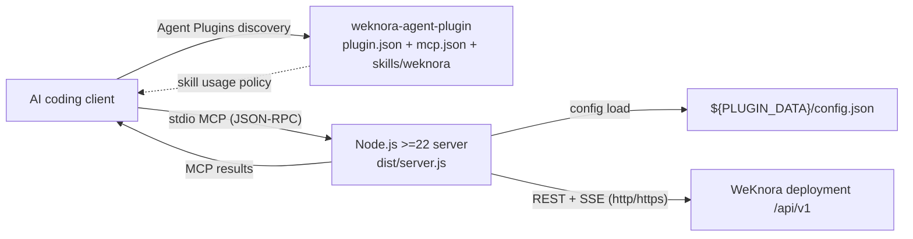

# 运行架构

状态：当前有效｜基线日期：2026-11-12｜决策依据：[ADR-0001](../adr/0001-portable-plugin-stdio-skill.md)、[ADR-0002](../adr/0002-typescript-node22-prebuilt.md)

## 架构总览

插件进程是纯适配层：不含 RAG 逻辑、不管理知识库、不执行模型。

## 模块边界

| 模块（预定路径） | 职责 | 不做 |
| --- | --- | --- |
| `src/config.ts` | 解析/归一/校验配置，产出 `ResolvedConfig` | 不读环境变量，不写配置文件 |
| `src/client.ts` | REST 调用、鉴权头、超时/取消、资源模式降级、SSE 聚合 | 不理解工具参数语义 |
| `src/tools.ts` | 四工具注册、输入校验、范围解析、预算/分页/截断、结构化结果与正文渲染 | 不直接发 HTTP（经 client） |
| `src/server.ts` | MCP 服务器生命周期、工具清单、请求分发、注解、错误映射 | 不做业务投影 |
| `src/index.ts` | CLI 入口：解析 `--config`、加载配置、启动服务 | 不提供多命令框架 |
| `skills/weknora/SKILL.md` | 模型使用策略：何时检索/续读/问答/续聊 | 不承载权限，不预授权工具 |

模块间只通过显式参数与返回值通信；`ResolvedConfig` 构造后只读。

## 进程生命周期

### 启动

1. 客户端按 `mcp.json` 启动：`node ${PLUGIN_ROOT}/dist/server.js --config ${PLUGIN_DATA}/config.json`。
2. 入口同步读取并校验配置（行为见[配置契约](configuration.md#缺失无效与启动行为)）。失败：向 stderr 输出一次性诊断（含违规项列表与配置路径），以非零码退出；**不向 stdout 写任何字节**。
3. 配置有效后构造 REST 客户端与工具注册表，初始化 MCP SDK stdio transport，开始服务 JSON-RPC。
4. 不做网络预检（连接探测延迟到首次工具调用），避免客户端启动阶段误判插件失败。

### 运行

- stdout 仅承载 MCP 协议帧；任何第三方库的 stdout 输出必须重定向到 stderr。
- 每个工具调用绑定独立的取消源；请求超时由调用取消与预算合成（Node `AbortSignal.any`）。
- 可见知识库全量列表按进程缓存一次，失败即清缓存允许重试（见[工具契约](tools.md#缓存)）。

### 关闭

- 收到 stdio EOF/SIGINT/SIGTERM：停止接受新请求，向在途请求广播取消，有界等待 REST 流中止，关闭 transport 后退出。
- 关闭路径不得向 stdout 写诊断；异常退出码非零。

## stdout / stderr 纪律

| 流 | 允许内容 | 禁止内容 |
| --- | --- | --- |
| stdout | MCP JSON-RPC 帧 | 诊断、banner、进度、第三方库日志 |
| stderr | 启动失败、致命错误、按需诊断（含时间与工具名） | `apiKey`/`tenantId`、完整响应体、会话内容转储 |

错误消息引用凭据时只使用字段名，不回显值。

## 取消与超时

| 维度 | 行为 |
| --- | --- |
| 客户端取消 | MCP 请求取消触发本地取消并传播到 fetch、SSE 读循环与流解析；返回标准 cancelled 结果，不产出部分成功。 |
| 普通请求预算 | `requestTimeoutMs`（默认 30000）应用于列库、搜索、按名搜索、读块、读元数据、建会话。 |
| 问答预算 | `chatTimeoutMs`（默认 300000）覆盖整个 SSE 问答流（含模型与工具执行时间）。 |
| 超时判定 | 取消与超时分开归因，错误消息指明哪个预算触发。 |
| SSE 完成条件 | 只有收到 `complete` 事件才算成功；`error` 事件或断流立即失败，半截回答不得作为成功结果返回。 |

## 错误 → MCP 结果映射

| 来源 | MCP 结果 | 要求 |
| --- | --- | --- |
| 工具参数缺失/类型错误 | tool error（invalid params 语义） | 消息指明工具与字段名，模型可据此修正。 |
| REST 传输失败（网络/DNS） | tool error | 含方法与路径、底层原因摘要；不 dump 响应体全文。 |
| REST HTTP 错误 | tool error | 含方法、路径、HTTP 状态与服务端原因（从错误 envelope 提取）。 |
| 非 JSON 响应 | tool error | 标记为协议异常，附截断片段。 |
| SSE `error` 事件 | tool error | 带事件内容。 |
| SSE 断流/无 `complete` | tool error | 明确"未完成"，不返回部分回答。 |
| 调用取消 | cancelled | 不产生结构化结果。 |
| 服务端未知字段/形状 | 容错投影 | 缺失字段以安全默认（`""`、`0`、`-1`）呈现，不崩溃（与上游一致）。 |

资源模式 403 降级不是错误：见[工具契约](tools.md#资源链接模式)。

## MCP 注解与副作用

| 工具 | readOnlyHint | destructiveHint | idempotentHint | openWorldHint | 依据 |
| --- | --- | --- | --- | --- | --- |
| `weknora_list_knowledge_bases` | `true` | `false` | `true` | `false` | 纯读取。 |
| `weknora_search` | `true` | `false` | `true` | `false` | 纯读取（含按名搜索增强）。 |
| `weknora_read_document` | `true` | `false` | `true` | `false` | 纯读取。 |
| `weknora_ask` | `false` | `true` | `false` | `true` | 创建/更新服务端会话；自定义 Agent 可能执行服务端配置的工具，其效果无法由插件界定，因此保守标注潜在破坏性。 |

约束：

- 注解是给客户端重试/审批策略的**真实描述**，不是权限执行机制。
- `ask` 绝不标注只读或幂等；客户端在连接故障后自动重放可能重复创建会话或触发服务端任务，文档与 Skill 必须如实说明。
- `ask` 的 `destructiveHint: true` 是**保守声明**：它描述"已配置的后端 Agent 可能执行的服务端工具效果"这一未知面，不是断言每次（甚至任何）RAG 问答都会破坏数据。插件不给"后端 Agent 绝不破坏数据"的笼统保证；没有证据能界定所有部署中 Agent 工具的效果边界。
- 上游 `isConcurrencySafe` 与 MCP 注解语义不同，不得机械映射；前三个工具并发安全，`ask` 的并发语义取决于服务端会话。

## 并发

工具调用可并发；检索类工具共享只读配置与 KB 列表缓存。`ask` 不在插件侧串行化（会话状态在服务端），但 Skill 引导模型对同一会话按顺序追问。

## 安全边界

- 不执行 shell，不读取配置路径与 `PLUGIN_ROOT`/`PLUGIN_DATA` 之外的文件。
- 不记录凭据；测试与日志不得包含真实 `apiKey`/`tenantId`。
- REST 端点接受 `http://`（本机部署）与 `https://`；生产部署建议 HTTPS，风险由部署方承担并在 README 说明。
- 插件不实现沙箱；进程权限等于启动它的客户端用户权限。
